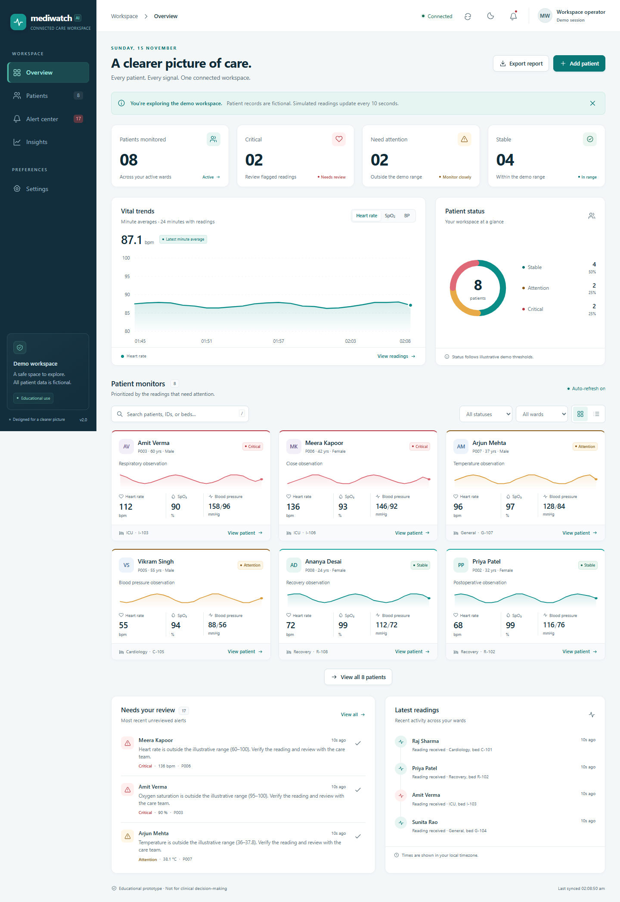

<div align="center">

# MediWatch AI

**Every signal. A clearer picture.**

A patient monitoring workspace that turns vital signs into a readable overview, a traceable history, and a focused review queue.

[](https://github.com/guptavernit2-afk/mediwatch-ai/actions/workflows/ci.yml)


[Get started](#get-started) · [What changed](#from-first-year-project-to-a-complete-workspace) · [API guide](docs/API.md) · [Deployment](docs/DEPLOYMENT.md)

</div>



> **Educational demonstration.** Seeded people, records, and readings are fictional. Thresholds are illustrative, summaries are unvalidated, and this project is not a medical device or a substitute for qualified clinical judgment. Keep real patient information out of public demo deployments.

## A more useful monitoring workflow

- **See the whole ward.** A responsive overview brings patient acuity, vital trends, active alerts, and recent activity together.
- **Find the right patient.** Search and filter the directory, inspect a patient's readings, and record new observations in a focused detail panel.
- **Keep a real history.** SQLite stores patients, timestamped readings, notes, and alert acknowledgements across restarts. Refreshing the dashboard does not invent new readings.
- **Review what needs attention.** Individual severe readings can flag a critical state. Alerts have a persistent acknowledgement workflow rather than disappearing on refresh.
- **Make the demo understandable.** Fictional records and a clearly marked simulator work immediately, without an API key. Non-demo mode starts empty and requires an API token.
- **Ask for a summary when needed.** Local rules provide a baseline summary; optional Groq integration runs on explicit request and sends a minimal, deidentified vitals payload.
- **Take the data with you.** Export the active patient snapshot as CSV with spreadsheet formula neutralization.
- **Use your preferred workspace.** Responsive layouts, keyboard-accessible controls, and light/dark themes support everyday exploration.

## Get started

Requirements: **Python 3.11 or newer**. The application has no frontend package installation or build step. Node.js 22 or newer is used for development checks and automated frontend tests.

```bash
git clone https://github.com/guptavernit2-afk/mediwatch-ai.git
cd mediwatch-ai
python -m venv .venv
```

Activate the environment:

```powershell
# Windows PowerShell
.venv\Scripts\Activate.ps1
```

```bash
# macOS / Linux
source .venv/bin/activate
```

Install and start:

```bash
python -m pip install -r requirements.txt
python -m uvicorn app:app --reload
```

Open **[http://localhost:8000](http://localhost:8000)**. The default demo seeds fictional records and generates readings in the background. No Groq account or key is required.

For configuration, copy `.env.example` to `.env` and adjust only the values you need. The example file documents the supported options. Do not commit `.env` or database files.

## From first-year project to a complete workspace

MediWatch began as a first-year FastAPI project: one Python file, an inline HTML dashboard, simulated vitals, and Groq recommendations. Version 2 keeps the original idea and the easy Python startup, while replacing the fragile parts.

| Original foundation                        | Refined application                                                           |
| ------------------------------------------ | ----------------------------------------------------------------------------- |
| In-memory patient list                     | Durable SQLite patients, readings, notes, and alerts                          |
| Random values generated by GET requests    | Read-only GET endpoints and a demo simulation lifecycle                       |
| AI requests during each dashboard refresh  | On-demand, bounded AI calls with a rules-based fallback                       |
| Alert severity based only on anomaly count | Per-vital severity so one severe reading is visible                           |
| One fixed dashboard layout                 | Overview, directory, alerts, insights, settings, and patient detail workflows |
| Unvalidated user input and raw CSV fields  | Typed validation, bed conflict checks, and safe CSV cells                     |
| Minimal repository setup                   | Regression tests, CI, container support, and operational documentation        |

## Project layout

```text
mediwatch-ai/
├── app.py                 # Uvicorn entrypoint and application factory
├── mediwatch/             # Configuration, persistence, monitoring, and API logic
├── web/                   # HTML, CSS, and browser-native JavaScript modules
├── tests/                 # Isolated API and persistence regression tests
├── docs/
│   ├── API.md             # Endpoint examples and request contracts
│   ├── ARCHITECTURE.md    # Data flow and design decisions
│   └── DEPLOYMENT.md      # Local, container, and hosted operation
├── .github/workflows/     # Automated verification
├── .env.example           # Safe configuration template
├── Dockerfile
├── requirements.txt
└── requirements-dev.txt
```

The application creates its data directory automatically. The database and its journal files are ignored by Git.

## Run the checks

```bash
python -m pip install -r requirements-dev.txt
python -m pytest -q
python -m compileall -q app.py mediwatch
```

Frontend regression tests and JavaScript syntax checks:

```bash
npm ci
npm test
npm run check
```

For automated browser workflow checks, install Chromium once and run:

```bash
npx playwright install chromium
npm run test:e2e
```

On Windows, you can also use an installed Microsoft Edge browser:

```powershell
$env:PLAYWRIGHT_CHANNEL = 'msedge'
npm run test:e2e
```

Browser tests start their own isolated server on `127.0.0.1:8765` with a temporary fictional database and no simulator or AI network access. Keep that port available; they do not touch your regular workspace database.

The backend suite uses temporary databases and disables background simulation and external AI calls. Frontend tests cover escaped rendering, filters, empty states, and timestamp-based chart aggregation. GitHub Actions runs the backend suite on Python 3.11 and 3.13, frontend regression tests, browser module syntax checks, and a separate Chromium workflow job.

## Deploy and extend

See the [deployment guide](docs/DEPLOYMENT.md) for persistent storage and container setup, the [architecture guide](docs/ARCHITECTURE.md) for implementation boundaries, and the [API guide](docs/API.md) for sensor ingestion examples.

Run one application worker when using the demo simulator. A hosted filesystem may be ephemeral: configure a persistent database volume before expecting records to survive redeployments. A GitHub push updates source; hosting must be configured separately.

This project provides a starting point for learning and portfolio demonstrations. Real clinical use would require validated monitoring rules, identity and role management, audit retention, encrypted backups, clinical governance, and a deployment appropriate to the applicable privacy requirements.

## Contributing

See [CONTRIBUTING.md](CONTRIBUTING.md) for the development workflow and [SECURITY.md](SECURITY.md) for reporting security issues. Built by [Vernit Gupta](https://github.com/guptavernit2-afk), refined from the original MediWatch AI project.
