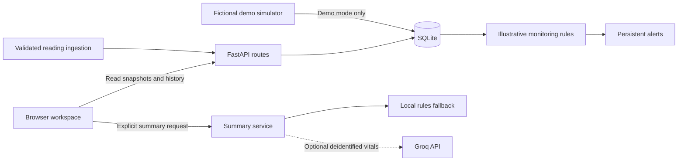

# Architecture

MediWatch keeps deployment small: one FastAPI process serves a browser-native frontend and a JSON API backed by SQLite. There is no JavaScript build step and no database server to provision for a local demo.

## Boundaries

`app.py` exports the ASGI `app` for Uvicorn and a `create_app` factory for isolated tests. The `mediwatch/` package contains the server implementation. Static files live in `web/`; the server exposes them under `/static` and serves the application shell at `/`.

The browser fetches snapshots periodically. A GET does not create readings, advance the simulator, acknowledge alerts, or call an external model. Writes use explicit POST/PATCH operations. This makes refreshes and repeated reads predictable.

Workspace trend charts group samples into timestamp-based minute buckets, use the latest available sample per patient in each bucket, and average those samples. A patient without a sample in a bucket does not contribute a fabricated value. This keeps unequal patient histories from being aligned by array position. The charts describe available readings rather than a continuously sampled population average.

## Data lifecycle

- Active patients have unique ward-and-bed assignments. Patient IDs remain unique after discharge.
- Readings are timestamped and persisted. A patient's current vitals and status are derived from their latest reading; trend charts use stored history.
- Notes persist with an author label and timestamp. Author labels identify a demo operator; they are not authenticated identity records.
- Monitoring anomalies carry per-vital severity. A single severe vital can make a patient's overall state critical.
- Alerts are stored separately from current patient status. Acknowledgement records review, and does not alter measurements or establish that a patient is safe.
- Discharge removes a record from the active directory and frees its bed while preserving its stored history.
- CSV export uses the current active patient snapshot and neutralizes formula-leading strings for spreadsheet use.

## Demo simulation

Demo mode seeds fictional records only when the database needs initialization. One process runs a background simulator that writes readings on a timed loop. Restarting the application reuses its database rather than resetting the workspace. Tests disable simulation through the application factory.

Keep a single Uvicorn worker when running the simulator: each additional process would otherwise start its own loop. Non-demo mode does not seed patients or simulate incoming readings.

## Summary generation

Routine monitoring and dashboard refreshes use transparent local rules. The summary endpoint can use Groq only when configured and explicitly invoked. The provider payload excludes direct identifiers such as patient names, record IDs, and bed assignments. A bounded request and a local fallback keep provider errors from breaking the dashboard.

Deidentification here reduces unnecessary disclosure; it does not establish legal anonymity or regulatory compliance. Provider output is unvalidated text for demonstration and must not be interpreted as diagnosis or treatment instructions.

## Security and scale limits

The default public demo is deliberately easy to explore. Non-demo mode requires a configured Bearer API token for protected API routes. The token is a shared access secret, not a complete account/permission system.

SQLite is appropriate for a small, single-instance educational workspace. Multi-instance deployment requires changes to storage coordination and simulator ownership. Real clinical use would also require validated data ingestion, role-based identity, audit guarantees, backups, deployment review, and clinical governance. None are implied by this project.
